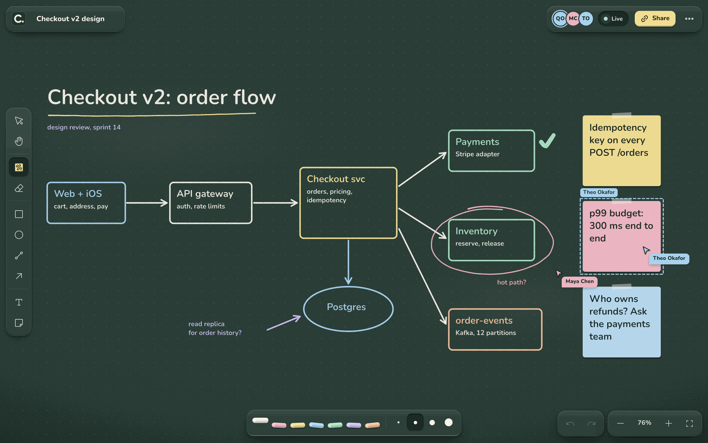
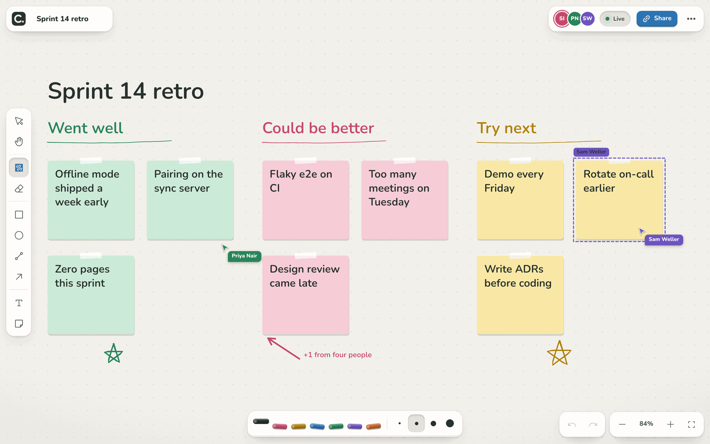
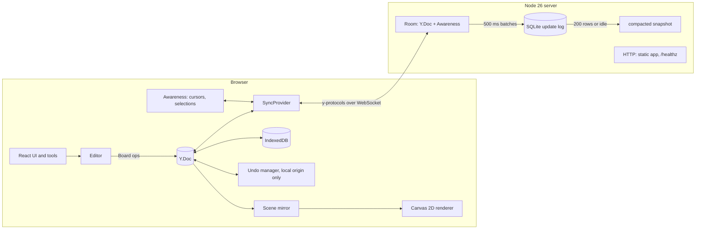

<picture>
  <source media="(prefers-color-scheme: dark)" srcset=".github/assets/banner-dark.svg">
  
</picture>

A real-time multiplayer whiteboard: open a link, draw with other people, keep drawing when the connection drops, and watch it all merge when it comes back.

[](https://github.com/EmirKonur/chalkline/actions/workflows/ci.yml)
[](LICENSE)
[](.nvmrc)
[](tsconfig.base.json)
[](docs/adr/0001-yjs-for-the-board-document.md)





## What it does

Whiteboards are where a design review or a retro actually happens, and they fail at the worst moments: on a train, in a hotel, or when the Wi-Fi in the meeting room gives up. Chalkline treats the network as optional. Every board is a CRDT document that lives in your browser (IndexedDB) and on a small sync server (SQLite). Edits apply locally first, reach everyone in the room while you are still drawing, and merge deterministically after any amount of time apart. Undo only ever undoes your own work.

The board itself is an infinite canvas with a pressure-sensitive chalk pen, rectangles, ellipses, lines, arrows, text, sticky notes, and an eraser; marquee and Shift selection, move, resize, duplicate, copy and paste; live cursors, a presence list, and a connection pill that tells you exactly how many changes are waiting while you are offline. It exports to PNG and SVG, has a `?` shortcut sheet, and comes in a slate chalkboard theme and a light whiteboard theme.

## Quick start

```sh
git clone https://github.com/EmirKonur/chalkline.git
cd chalkline
pnpm install
pnpm dev
```

Open <http://localhost:4110> and start a board, then open the same link in a second window. Vite serves the app on 4110 and proxies `/sync` to the server on 4111. To get a realistic board with two collaborators already on it:

```sh
pnpm seed:demo --room demo-checkout --peers
# then open http://localhost:4110/b/demo-checkout
```

One container serves both the app and the sync server, with the database on a volume:

```sh
docker compose up --build    # http://localhost:4110
```

Requirements: Node 23.6 or newer (CI and the image use Node 26 LTS) and pnpm 9.15. Configuration is in [`.env.example`](.env.example).

## Architecture



A gesture (say, a pen stroke) runs in the `Editor`, which writes to the document through `Board`, a typed wrapper in `packages/core` that is the only code allowed to touch Yjs types. The document change fans out three ways: the `Scene` updates its plain-object mirror and asks the renderer for a frame, IndexedDB stores the update, and the provider sends it to the server, which applies it to the room's copy, relays it to everyone else, and writes it to SQLite in batches. Remote updates come back through the same path in reverse. Presence travels separately through Yjs awareness and is never stored. More detail, including sequence diagrams for joining and reconnecting, is in [docs/architecture.md](docs/architecture.md).

## Deep dive: conflict-free collaboration

### Modeling the board so concurrent edits merge sensibly

The document is a `Y.Map` of shapes keyed by a random id, each shape a nested `Y.Map` of fields. Yjs resolves concurrent writes per field, last writer wins, so the schema decides what "a conflict" means:

- A move writes `x` and `y` in one transaction. Two people dragging the same shape converge on one person's drop point, never a blend of both, because both writes start from the same previous values and Yjs picks the same winner for each field. A move and a recolor by different people both survive.
- Pen points are a nested `Y.Array` that grows while the stroke is drawn, so collaborators watch it appear. Points are stored as fixed-point integers because Yjs encodes integers as varints but other numbers as 8-byte floats. Measured on a 600-point stroke streamed as 102 updates: 6.2 KB of update log with integers, 17.9 KB with floats.
- Text and sticky notes hold a `Y.Text`. The editor applies each keystroke as a minimal splice (`applyTextDiff`), never splitting a UTF-16 surrogate pair, so two people typing in one note keep both edits.
- Resizing a stroke writes two scale factors (`sx`, `sy`) instead of rewriting every point.

Stacking order is not array position. A `Y.Array` cannot move an element (a move is delete plus insert), so two people bringing the same shape to the front would leave two copies of it. Instead each shape has a fractional index `z`, and the board renders in `(z, id)` order. Moving a shape forward writes one string between its neighbors:

```ts
// packages/core/src/zorder.ts
export function keyBetween(a: string | null, b: string | null, random = Math.random): string {
  const base = generateKeyBetween(a, b);
  const suffix =
    (JITTER_DIGITS[Math.floor(random() * JITTER_DIGITS.length)] ?? 'V') +
    (JITTER_DIGITS[Math.floor(random() * JITTER_DIGITS.length)] ?? 'V');
  const jittered = base + suffix;
  return b === null || jittered < b ? jittered : base;
}
```

The random suffix matters: two clients that bring different shapes to the front at the same moment would otherwise generate the identical key, and nothing could ever be inserted between them. `rekey` also re-keys any run of equal keys it encounters, so the order self-heals. [ADR 0004](docs/adr/0004-shapes-in-a-map-with-fractional-z-order.md) has the trade-offs.

### The sync protocol

The client and server speak y-protocols in the y-websocket wire format. On connect each side sends a sync step 1 (its state vector) and answers the other's with a step 2 (exactly the updates the other side lacks). After that, every local transaction is sent as an update and the room relays it to every other socket.

```ts
// packages/core/src/provider.ts
const kind = syncProtocol.readSyncMessage(decoder, encoder, this.doc, this);
if (kind === syncProtocol.messageYjsSyncStep1) {
  // The reply is a step 2 holding everything the server lacks, which
  // includes every edit made while disconnected.
  sendBytes(socket, encoding.toUint8Array(encoder));
  this.handshakeDone = true;
  this.setStatus({ pending: 0 });
} else if (kind === syncProtocol.messageYjsSyncStep2) {
  this.attempts = 0;
  this.setStatus({ phase: 'online', synced: true, closeCode: null });
}
```

Browsers cannot see WebSocket pings, so dead connections are found with the protocol itself: after 20 s of silence the client sends a step 1, which the server must answer, and after 30 s the socket is replaced. The probe doubles as a repair, since its step 2 carries anything lost in transit. Reconnects back off from 500 ms to 15 s with jitter, so a restarted server is not hit by every client at once.

### Presence

Cursors, selections, and "who is typing in which note" use Yjs awareness: ephemeral state that each client renews every 15 s and that expires after 30 s of silence. Cursor updates are throttled to one per 40 ms; the receiving side eases each remote cursor toward its latest position in world coordinates every frame, which hides network jitter and keeps cursors glued to the board while you pan. The server tracks which awareness ids each socket speaks for, so when a socket closes everyone sees that person leave immediately. If a client reconnects before its old socket has timed out, its id moves to the new socket, so the old socket's eventual close does not erase a live cursor.

### Undo that only undoes your work

```ts
// apps/web/src/editor/history.ts
this.manager = new Y.UndoManager([board.shapes, board.meta], {
  trackedOrigins: new Set([board.origin]),
  captureTimeout: Number.POSITIVE_INFINITY,
});
```

Only transactions tagged with this client's origin are captured, so remote edits can never be undone from here. Yjs also refuses to restore a value someone else has overwritten since: if you move a shape and a collaborator then moves it again, your undo leaves their position alone. Capturing is cut explicitly at gesture boundaries rather than by timeout, because a timeout splits a slow pen stroke into several undo steps whenever the pointer pauses. The tests in [`history.test.ts`](apps/web/src/editor/history.test.ts) cover each of these with two connected documents, and an e2e test checks it across two real browsers.

### Offline, and counting what is waiting

The board loads from IndexedDB before the socket opens, so its first state vector already reflects the cache and the server only sends what changed. Edits made offline go into the doc and IndexedDB as usual. The connection pill counts them, and the count is persisted, so a reload while offline still shows it. A naive count of transactions would report dozens of changes for one pen stroke, so the count is undo steps instead:

```ts
// apps/web/src/board/session.ts
isUserEdit: (origin) => history.isLocal(origin) && history.takeFreshStep(),
```

`takeFreshStep()` is true once per undo step. It works because Yjs emits the undo manager's `stack-item-added` before the document's `update` event in the same transaction.

### Server persistence and compaction

Rooms buffer incoming updates for 500 ms and append them to SQLite (`node:sqlite`) as one merged row. When a room reaches 200 rows, goes idle for 30 s, or the server shuts down, its rows are replaced in one transaction by a single snapshot of the live document:

```ts
// apps/server/src/room.ts
flush(): void {
  this.clearFlushTimer();
  if (this.buffer.length === 0) return;
  const merged =
    this.buffer.length === 1 ? (this.buffer[0] as Uint8Array) : Y.mergeUpdates(this.buffer);
  this.buffer = [];
  this.store.append(this.id, merged);
  this.rows += 1;
  if (this.rows >= this.options.compactAfterUpdates) this.compact();
}
```

The snapshot comes from the live doc rather than from merging rows because the live doc has garbage-collected deleted content: the 600-point stroke above, once erased, compacts to 44 bytes. [ADR 0005](docs/adr/0005-sqlite-update-log-with-compaction.md) covers the choice of storage.

### Failure cases this handles

- **Two people move the same shape.** Each sees the other's drag live; the final position is whoever wrote last, as a unit (tested in `board.test.ts`).
- **Someone deletes a shape you are moving.** The delete wins, your drag ends cleanly, and a toast says what happened.
- **Someone deletes the note you are typing in.** The delete wins, but the editor keeps the text and offers "Restore it", which puts your copy back as a new note.
- **A long offline session.** Both sides' edits merge on reconnect; a shape deleted by someone else stays deleted even if you moved it offline (tested through the real server).
- **The server loses data.** If a crash drops the last 500 ms, or the database is gone entirely, any client that still has the edits restores them on reconnect. The integration suite restarts the server on an empty database to prove it.
- **Concurrent bring to front.** Jittered keys keep the two shapes distinct and orderable.
- **A misbehaving client.** Every field read from the shared document is validated; a malformed shape is skipped rather than crashing every renderer, and a malformed frame closes only that socket.

## Rendering

The board is drawn with Canvas 2D on demand, culled by bounding box, with cached stroke outlines and a chalk grain applied as a per-ink pattern fill (so sticky-note paper stays clean). `pnpm bench:render` seeds 2,000 mixed shapes over a real socket and drives pan and pinch-zoom for 4 s per scenario. On an Apple M2 Pro (macOS 15, Chromium 156 via Playwright, 1440x900 at 2x, `--headed`):

| Scenario                          | FPS   | Render mean / p95 (ms) | Shapes drawn per frame |
| --------------------------------- | ----- | ---------------------- | ---------------------- |
| Pan with all 2,000 shapes in view | 119.7 | 3.37 / 3.8             | 1,931                  |
| Pan at 100% zoom (culling active) | 120   | 0.49 / 0.6             | 160                    |
| Pinch-zoom sweep                  | 120   | 3.10 / 3.8             | 1,771                  |

The display refreshes at 120 Hz, so that is the ceiling. Headless Chromium uses a software rasterizer and is much slower at filling a 2880x1800 canvas (about 15 FPS with everything in view, 60 FPS at 1x with culling), even though the time spent in the renderer is the same. [ADR 0003](docs/adr/0003-canvas-2d-rendering.md) has the full numbers and why Canvas beat SVG.

## Design decisions

- [0001: Yjs CRDTs for the board document](docs/adr/0001-yjs-for-the-board-document.md), over OT and Automerge.
- [0002: A small ws + y-protocols server](docs/adr/0002-own-sync-server.md), over Hocuspocus.
- [0003: Canvas 2D rendering](docs/adr/0003-canvas-2d-rendering.md), over SVG and WebGL, with measurements.
- [0004: Shapes in a Y.Map, stacking by fractional index](docs/adr/0004-shapes-in-a-map-with-fractional-z-order.md), over a Y.Array.
- [0005: SQLite update log with compaction on node:sqlite](docs/adr/0005-sqlite-update-log-with-compaction.md), over snapshots and LevelDB.

Smaller choices: colors are stored as ink tokens and mapped per theme, so a board reads well in either theme; the server runs its TypeScript directly with Node's type stripping, so the image has no server build step and no native modules; boards are capability URLs with no accounts.

## Testing

```sh
pnpm test        # 111 unit and integration tests (Vitest)
pnpm test:e2e    # 6 Playwright tests, two browser contexts on one board
pnpm lint && pnpm typecheck
```

- `packages/core`: document operations under concurrency, text merging, fractional keys (property tests with fast-check), point encoding.
- `apps/server`: the SQLite store, config parsing, and an integration suite that runs the real server in-process with real `SyncProvider` clients: live sync, room isolation, presence and its cleanup, offline edits merging, delete versus offline move, restart from SQLite, compaction, recovery from a server that lost everything, and rejected room ids.
- `apps/web`: geometry, hit testing, marquee and eraser sweeps, resize transforms (property tests), camera math, wheel classification, text layout, caret transformation under remote edits, clipboard parsing, SVG export, the scene mirror, and per-user undo.
- E2E: a stroke drawn in one browser appears in the other (checked in the canvas pixels), the other person's cursor appears, undo leaves the other person's stroke alone, offline edits are counted and sync on reconnect, a late joiner sees the board fitted to view, plus the landing flow, cheatsheet, and 404.

## Project structure

```
packages/core/       schema, Board operations, z-order keys, wire protocol, SyncProvider
apps/server/
  src/               config, SQLite store, Room, Rooms, HTTP + WebSocket server
  test/              store and config tests, in-process sync integration tests
apps/web/
  src/editor/        Editor, tools, Scene, History, Presence, shortcuts, clipboard
  src/geometry/      vectors, bounds, hit testing, transforms, camera, wheel, text layout
  src/render/        Canvas 2D renderer, pen outlines, ink textures
  src/board/         session wiring, canvas view, toolbars, presence, status, dialogs
  src/export/        PNG and SVG export
  e2e/               Playwright tests
  scripts/           demo seeding and the render benchmark
docs/                architecture notes and ADRs
```

## Roadmap

- Arrows that bind to shapes and follow them when the shapes move.
- Cross-tab sync with a `BroadcastChannel`, so two tabs of the same board stay in step while offline.
- Optional access control: signed board links checked during the WebSocket upgrade.
- A spatial index for boards past roughly 20,000 shapes, where linear culling starts to show.
- Running more than one server instance, with rooms routed by id.

## License

[MIT](LICENSE)
