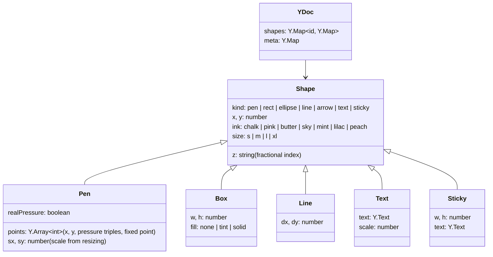
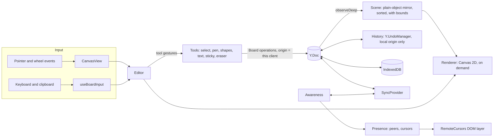
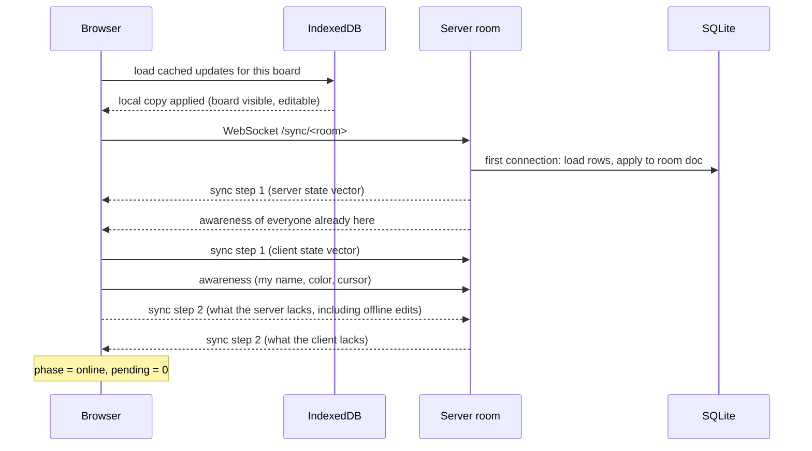
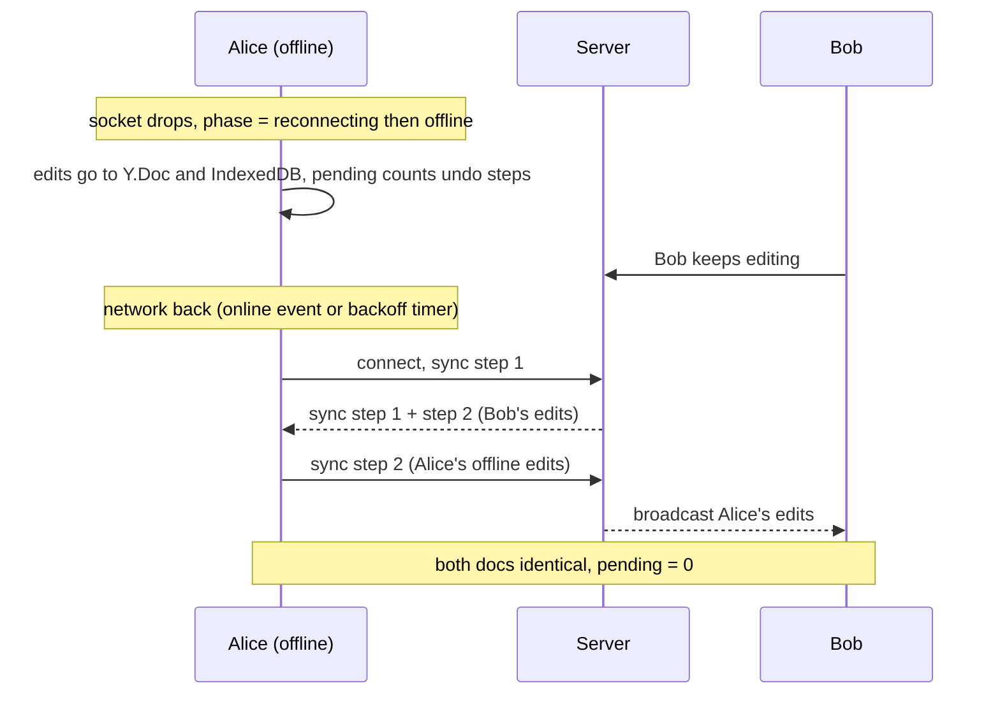
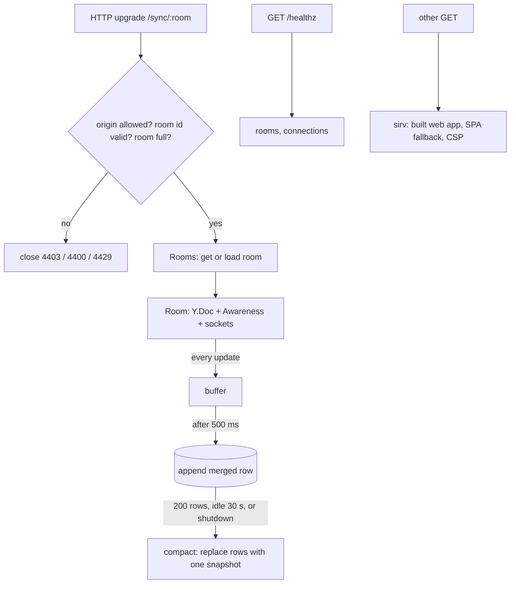

# Architecture

Chalkline is three packages in one pnpm workspace:

| Package         | Runs in          | Responsibility                                                                                                                         |
| --------------- | ---------------- | -------------------------------------------------------------------------------------------------------------------------------------- |
| `packages/core` | browser and Node | Document schema and typed operations (`Board`), stacking keys, point encoding, the wire protocol, and the sync client (`SyncProvider`) |
| `apps/server`   | Node 26          | HTTP + WebSocket server: one in-memory room per active board, SQLite update log, static files for the built web app                    |
| `apps/web`      | browser          | Editor model, tools, Canvas 2D renderer, React UI, IndexedDB persistence                                                               |

The core package exists because three programs need the same document code: the
browser, the server's integration tests, and the scripts that seed demo boards and
run the render benchmark. It is consumed as TypeScript source (no build step); Vite
compiles it for the browser and Node strips types at runtime.

## Data model

Colors are ink tokens, not hex values. Each theme maps tokens to its own colors
(`apps/web/src/theme/palette.ts`), so a pastel pink drawn on the chalkboard shows
up as a deeper marker pink for someone viewing the same board in the whiteboard
theme, with contrast intact for both.

`meta` holds the board title. Presence (cursors, selections, who is typing where)
is not in the document; it travels through Yjs awareness and is never stored.

## Client

- **Editor** (`editor/editor.ts`) owns the camera, selection, active tool, text
  editing state, and clipboard. It has no DOM; `CanvasView` translates pointer
  events into board coordinates and feeds them in, which keeps the interaction
  logic testable without a browser.
- **Scene** (`editor/scene.ts`) mirrors the `shapes` map into plain objects with
  precomputed bounds. It updates incrementally from deep-observe events and tracks
  two versions per shape: `version` (any change) and `geomVersion` (changes that
  alter the shape's own outline). Moving a stroke changes `x`/`y` only, so its
  cached `Path2D` is reused.
- **Renderer** (`render/renderer.ts`) runs only when something marks the frame
  dirty, culls by bounding box, and draws overlays (selection, other people's
  selections, marquee, eraser) on the same canvas after the shapes.
- **Tools** write to the document as the gesture happens. A pen stroke is created
  on pointer down and its points are appended on every pointer move, so other
  people see the line being drawn. Undo boundaries are cut explicitly at the start
  and end of each gesture.

## Sync

### Joining a board

The client waits for IndexedDB before opening the socket. Its first state vector
then reflects the cache, and the server's step 2 carries only what changed since
the last visit.

### Live editing

Every local transaction produces a Yjs update. The provider sends it as a sync
`update` message; the room applies it to its doc (origin = the sending socket),
broadcasts it to every other socket, and buffers it for the next write. Awareness
works the same way, except that the server also records which awareness client ids
each socket speaks for, so it can broadcast their removal when the socket closes.

### Going offline and coming back

Reconnect uses exponential backoff (500 ms doubling to 15 s, with jitter so a room
full of clients does not stampede a restarted server). The browser's `offline`
event drops the socket immediately instead of waiting for a timeout.

### Liveness

Browsers do not expose WebSocket ping frames to JavaScript. After 20 s without
any message, the client sends a sync step 1, which the server must answer with a
step 2; after 30 s of silence the socket is considered dead and replaced. The
server separately pings every 30 s and terminates sockets that do not answer.

## Server

- Rooms load synchronously (node:sqlite is synchronous), so two sockets joining a
  cold room cannot both load it.
- A malformed frame closes that socket with 1007; other sockets in the room are
  unaffected.
- On SIGTERM the server closes sockets with 1001, flushes and compacts every room,
  then closes the database. Clients reconnect with backoff to the next instance.

## Undo

`History` wraps `Y.UndoManager` scoped to the `shapes` and `meta` maps, tracking
only transactions whose origin is this client's board origin. Remote updates are
applied with the provider as origin and are never captured. When undoing a change
whose value someone else has since overwritten, Yjs declines to restore it, so
undo never clobbers newer work by a collaborator. Each stack item stores the
selection at the time of the change, and undo restores it.

## Security notes

Boards are capability URLs: anyone with the link can read and edit. There are no
accounts. The server validates room ids, caps message size (8 MB) and connections
per room (64), can restrict WebSocket origins with `ALLOWED_ORIGINS`, and serves the
app with a strict Content Security Policy (`default-src 'self'`). All document
content is treated as untrusted input on every client.
